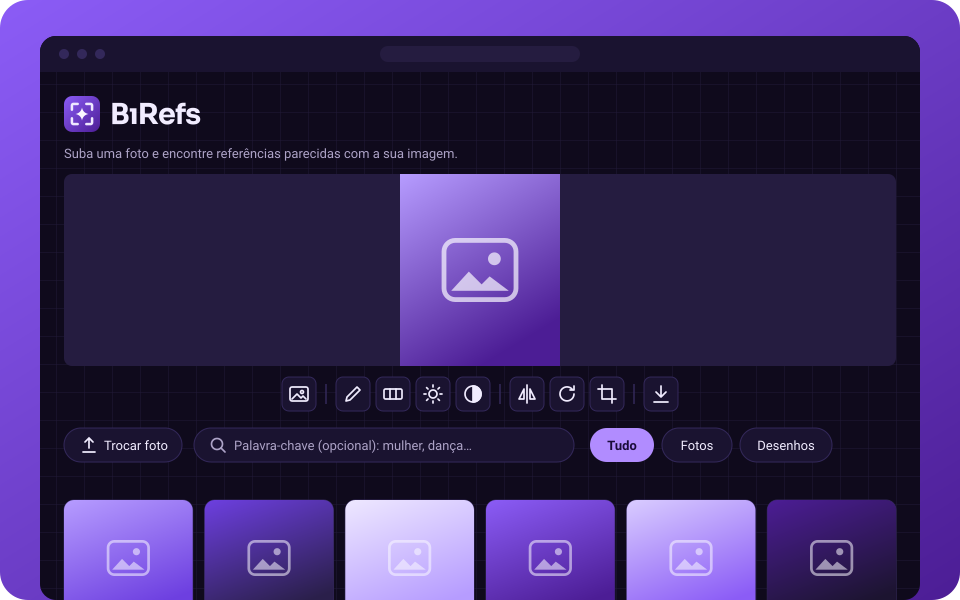

<p align="center">
  <picture>
    <source media="(prefers-color-scheme: dark)" srcset="docs/brand/logo-dark.svg">
    
  </picture>
</p>

<p align="center">
  <b>Bring Image References</b><br>
  Você sobe uma imagem e encontra referências parecidas: a mesma pose, o mesmo ângulo de rosto, a mesma mão ou o mesmo assunto.<br>
  <a href="https://birefs.pages.dev">birefs.pages.dev</a>
</p>

<p align="center">
  
</p>

O BiRefs é um projeto pessoal, gratuito e sem fins lucrativos, feito para quem desenha e precisa de referência.

## O que ele faz

- **Busca por imagem:** acha referências pela pose do corpo, pelo ângulo do rosto e pela posição da mão. Quando a imagem não tem pessoa (animal, objeto, desenho estilizado), busca pelo assunto e pelo estilo.
- **Mais de 9 mil referências livres:** fotos e desenhos do Openverse, Wikimedia Commons e Open Images, e obras dos acervos abertos do Met, National Gallery of Art, SMK, Wellcome Collection e Rijksmuseum.
- **Refino:** palavra-chave em português ou inglês e filtro de fotos ou desenhos.
- **Editor para estudo:** rabisco, valores, brilho, contraste, espelhar, girar e recortar. Dá para buscar com a imagem editada e baixar o resultado.
- **Outras fontes:** obras do DeviantArt pela palavra-chave, e botões que abrem a busca do Pinterest e do Google Lens em outra aba.
- **Celular e offline:** funciona no celular e pode ser instalado como app (PWA).

## Princípios

- **Grátis de verdade:** sem anúncios, sem cadastro, sem assinatura e com custo zero para hospedar.
- **Privado:** a IA roda no seu navegador e a foto não sai do aparelho. Veja a [política de privacidade](https://birefs.pages.dev/privacidade).
- **Com crédito:** só imagens CC0, CC BY ou em domínio público, sempre com autor, licença e link para a fonte. As imagens são carregadas do servidor original.

## Tecnologias

| Parte | Ferramenta |
| --- | --- |
| Site | Vite, React, TypeScript, SCSS |
| IA no navegador | MediaPipe Tasks Vision (Face, Pose e Hand Landmarker) e CLIP ViT-B/32 com ONNX Runtime Web (semelhança geral) |
| Hospedagem e API | Cloudflare Pages, Pages Functions com Hono |
| Dados | Cloudflare D1 (cota exata) e KV (cache do token do DeviantArt) |
| Índice | Script Python com MediaPipe e CLIP sobre Openverse, Wikimedia, Open Images e acervos de museus, gerando JSON estático em `public/index/` |
| Testes | Vitest |

## Como rodar

Precisa de Node 22+ e, para gerar o índice, do [uv](https://docs.astral.sh/uv/).

```bash
npm install
npm run dev          # só o site, em http://localhost:5173
npm run pages:dev    # site + API, como no Cloudflare, em http://127.0.0.1:8788
npm test
```

Para refazer o índice (algumas horas; se parar, ele retoma de onde estava):

```bash
npm run index
npm run index -- --selftest   # confere se o Python calcula igual ao site
```

Para publicar:

```bash
npm run build
npx wrangler pages deploy --branch main
```

## API

| Rota | O que faz |
| --- | --- |
| `GET /api/deviantart?tag=` | Busca por tag no DeviantArt, sem IA e sem conteúdo adulto. Devolve título, autor, miniatura e link. |
| `POST /api/web` | Envia a foto ao Google Vision. Precisa de `consent=true` e imagem JPEG, PNG ou WebP de até 4 MB. Tem limite por IP e cota mensal. A rota existe, mas o site ainda não tem o botão que a usa. |
| `GET /api/quota` | Diz se a busca do Google Vision ainda tem cota no mês. |

Sem as chaves, as rotas respondem `503` dizendo o que falta. A coleção **BiRefs** no Postman tem as três rotas prontas para testar.

### Chaves

Nada de chave no código. Para testar localmente, copie `.dev.vars.example` para `.dev.vars` (que fica fora do git). Em produção:

```bash
npx wrangler pages secret put DEVIANTART_CLIENT_ID
npx wrangler pages secret put DEVIANTART_CLIENT_SECRET
npx wrangler pages secret put GOOGLE_VISION_KEY
```

Antes do primeiro deploy, crie o KV e o D1 (`npx wrangler kv namespace create birefs` e `npx wrangler d1 create birefs`), troque os ids `"local"` no `wrangler.toml` e rode `npx wrangler d1 migrations apply birefs --remote`.

## Fases

0. Protótipo: índice de exemplo e busca por ângulo no navegador. **(feito)**
1. MVP: índice maior, semelhança geral, celular e PWA. **(feito)**
2. DeviantArt por tag, acervos de museus e busca pelo assunto da imagem com CLIP. **(atual)**
3. Favoritos no localStorage, timer de sessão de desenho e crânio 3D opcional.

Em avaliação: login com o Pinterest para usar os próprios pins como referência (acesso à API pedido) e o botão do Google Vision.
